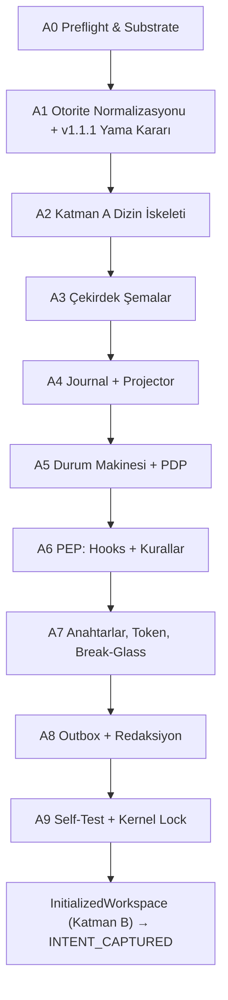

# Meta-OS v1.1 — System Blueprint (Day-0, GENESIS_MORPHING)

> [!IMPORTANT]
> **Durum:** `GENESIS_MORPHING` → `GENESIS_LOCKED` için `UserApprovedProfile` bekleniyor.
> Proje klasörüne **hiçbir dosya yazılmadı / değiştirilmedi.** Tüm denetimler salt-okunurdu. Metin çıkarımı yalnız bu konuşmanın `scratch/` dizininde yapıldı.
> Kanıt seviyesi: bu rapordaki "VERIFIED" ibareleri yalnız **bu oturumda yerelde çalıştırılan komutlara** dayanır (I-10). Web tabanlı Tech Radar taraması henüz yapılmadı; `TECH_RADAR_SYNC` fazına bırakıldı.

---

## 0. Ön Bulgu — Otorite Dosyaları Makine-Okunur Değil (I-07 / I-04 ihlali)

| Dosya | Görünen tür | Gerçek tür (`file`) | SHA-256 (snapshot) |
|---|---|---|---|
| `SPEC_META_OS.md` | Markdown | **Microsoft Word 2007+ (.docx)** | `1e9810610ceff163ff4117f82f3a520e8c9a6381a95bd712c3f2af97504f479e` |
| `.antigravity/schemas/invariants_and_states.json` | JSON | **Microsoft Word 2007+ (.docx)** | `13b60d910e97d181eec5544c5bfc94077f8eb6170f17b0a8a11e9481092d66f7` |

- İçerik `textutil` ile scratch'e çıkarılıp tam olarak okundu (spec: 194 satır, 14 bölüm; JSON: 15 invariant, 22 lifecycle + 11 istisna geçişi). Çıkarılan JSON sözdizimsel olarak geçerli görünüyor.
- **Sonuç:** Makine otoritesi (I-07) şu an bir Word ikili dosyası; kanonik hash (I-04) anlamsal değil, Google Docs dışa aktarımına bağlı. → Faz A1'de gerçek UTF-8 `.md`/`.json`'a dönüştürülmesi **REQUIRED** (orijinal `.docx`'ler hash'iyle "kaynak türev" olarak arşivlenir).

---

## 1. Gerçeklik ve Yetenek Denetimi (Capability Audit)

### 1.1 Doğrulanmış Ortam Snapshot'ı (`CapabilityManifest` ön taslağı)

| Alan | Bulgu | Durum |
|---|---|---|
| OS / Mimari | macOS 26.5.2 (25F84), arm64 | VERIFIED |
| Kullanıcı | `oeckoculu` (uid 502, `admin` grubunda); sistemde ikinci kullanıcı mevcut | VERIFIED |
| Proje FS | Google Drive **File Provider** (`com.apple.fileprovider` xattr), APFS Data volume üzerinde | VERIFIED |
| Yol hijyeni | Yolda `'` (Drive'ım) ve **U+2011 non-breaking hyphen** (`AI‑Native`) var | VERIFIED — script'lerde quoting/NFC riski |
| Ağ (komut sandbox'ı) | DNS çözümlemesi başarısız → default-deny egress | VERIFIED |
| Agent araçları | `read_file`, `write_file`, `edit_file`, `run_command` (sandbox / onaylı bypass), `search_web`, subagent, `schedule`, `ask_question` | VERIFIED (araç listesi) |
| MCP adaptörleri | Bu oturumda çağrılabilir **hiçbir MCP aracı yok**; `~/.gemini/antigravity/` sandbox'tan okunamıyor | VERIFIED (yokluk) |
| Antigravity Hooks | `.agents/hooks.json`, `PreToolUse` → `allow/deny/ask` (yerel resmi doküman) | DOCUMENTED, **henüz test edilmedi** |

### 1.2 Araç Zinciri

| Araç | Sonuç | Not |
|---|---|---|
| `git` | ❌ **Xcode CLT shim** — çalışmıyor | I-04 (commit SHA), I-09 (worktree) için **bloklayıcı** |
| `python3`, `pip3`, `make` | ❌ CLT shim | Gerçek Python yok |
| `java` | ❌ Runtime yok | — |
| `node/npm/pnpm/bun/deno`, `uv`, `go`, `rustc` | ❌ Yok | — |
| `docker/podman/colima/lima/orbctl` | ❌ Yok | Ephemeral container **yok** |
| `opa/conftest/cue`, `cosign/syft/grype/trivy/gitleaks/semgrep` | ❌ Yok | PDP/SBOM/SAST harici aracı yok |
| `gh/glab/acli/jira` | ❌ Yok | Uzak entegrasyon CLI'ı yok |
| `jq` 1.7.1 | ✅ Çalışıyor (`-S` key sort doğrulandı) | RFC 8785 JCS **değil** (sayı/unicode kanonikleştirme eksik) |
| `sqlite3` 3.51.0 | ✅ | State projection / sorgu için uygun |
| `shasum -a 256`, `openssl` (LibreSSL 3.3.6) | ✅ | LibreSSL'de **Ed25519 yok** |
| `ssh-keygen` (OpenSSH 10.2p1) | ✅ `-Y sign` alt komutu mevcut | SSHSIG/Ed25519 imza yolu **mümkün** (anahtarla uçtan uca test edilmedi) |
| `perl` 5.34, `osascript -l JavaScript` (JXA) | ✅ | Yedek betik çalışma zamanları |
| `chflags uappnd` | ✅ APFS `/tmp`'de: ekleme izinli, üzerine yazma reddedildi | Aynı kullanıcı bayrağı kaldırabilir → yalnız ayrı sahiplikle anlamlı. Drive FS'te **doğrulanmadı** |
| `sandbox-exec` (iç içe) | ❌ `sandbox_apply: Operation not permitted` | Agent sandbox'ı içinde ikinci sandbox kurulamıyor |

> [!WARNING]
> Shim çağrıları macOS'ta bir **"Command Line Developer Tools" kurulum diyaloğu** tetiklemiş olabilir. Ben kurulum başlatmadım; diyaloğu kapatabilir veya karar sorusundaki seçeneğe göre bırakabilirsiniz.

### 1.3 Altı Düzlem — Çalışabilirlik Etiketleri

Biçim: **Etiket** = spesifikasyona göre önem; **Bugünkü durum** = bu ortamda gerçekleştirilebilirlik.

#### A. Genesis & Evolution
| Bileşen | Etiket | Bugünkü durum |
|---|---|---|
| Intent & Archetype Interrogator | REQUIRED | ✅ Agent + `ask_question` ile mümkün |
| Capability Discovery & Live Tech Radar | REQUIRED | ⚠️ Yerel keşif ✅; canlı tarama yalnız agent `search_web` ile (komut sandbox'ı ağsız) → çıktı `UntrustedContentEnvelope`'a zorunlu |
| Topology & Toolchain Synthesizer | REQUIRED | ❌ Çalışma zamanı yok (git/python) → bloklu |
| Risk Profile & Gate Scheduler | REQUIRED | ⚠️ Saf deterministik mantık; runtime gerekiyor |
| Upstream Template Sync PR Generator | OPTIONAL | ❌ git + gh + ağ yok → ertelendi |

#### B. Control
| Bileşen | Etiket | Bugünkü durum |
|---|---|---|
| Workflow Orchestrator | REQUIRED | ⚠️ Journal-replay tabanlı yerel durum makinesi (Temporal vb. UNSUPPORTED) |
| Policy Decision Point | REQUIRED | ⚠️ Gömülü, default-deny JSON kural yorumlayıcı (RECOMMENDED); OPA/Rego adaptörü OPTIONAL |
| Admission Controller | REQUIRED | ⚠️ PDP ile aynı runtime'a bağlı |
| Capability/Lease Manager | REQUIRED | EXPERIMENTAL — token imzası `ssh-keygen -Y` ile; PEP olarak `PreToolUse` hook (test edilene kadar) |
| Human Decision Queue & Break-Glass | REQUIRED | ✅ CLI/Markdown + insan SSH anahtarı (anahtar workspace dışında, parolalı) |
| Event Journal & State Projector | REQUIRED | ✅ JSONL + hash zinciri + `sqlite3`/`jq` projeksiyon (JCS için runtime gerekli) |

#### C. Execution
| Bileşen | Etiket | Bugünkü durum |
|---|---|---|
| Ephemeral sandbox/container/VM | REQUIRED | ❌ **UNSUPPORTED** (konteyner motoru yok). Degrade mod: `/tmp` worktree + onaylı executor |
| Privileged Executor | REQUIRED | ⚠️ `BypassSandbox` = insan onaylı komut → doğal insan kapısı; tam izolasyon için ayrı OS kullanıcısı |
| Git worktree | REQUIRED | ❌ git yok → **bloklayıcı** |
| Geçici DB / test env | OPTIONAL (arketipe bağlı) | ⚠️ `sqlite3` var; Testcontainers/CoW DB UNSUPPORTED |
| Egress proxy & allowlist | RECOMMENDED | ⚠️ Default-deny ✅; ince taneli allowlist UNSUPPORTED |

#### D. Evidence
| Bileşen | Etiket | Bugünkü durum |
|---|---|---|
| Contract registry + `spec.lock.json` | REQUIRED | ⚠️ RFC 8785 JCS implementasyonu için runtime gerekli |
| Test/mutation/perf/security artefaktları | RECOMMENDED (arketipe bağlı) | ❌ Araçların hiçbiri yok; Genesis'te dile göre bağlanacak |
| SBOM, provenance, imzalar | RECOMMENDED | ⚠️ SSHSIG imza ✅; syft/cosign yok; in-toto/SLSA formatı EXPERIMENTAL |
| Proof receipt generator | REQUIRED | ⚠️ Runtime'a bağlı |
| Audit store & Meta-Metrics | RECOMMENDED | ⚠️ JSONL metrik; OTel collector UNSUPPORTED |

#### E. Integration
| Bileşen | Etiket | Bugünkü durum |
|---|---|---|
| HumanInteractionPort (yerel CLI/MD) | REQUIRED | ✅ |
| Jira/Confluence Adapter | OPTIONAL | ❌ MCP/CLI yok → **I-11 outbox fallback birincil** |
| GitHub/GitLab Adapter | OPTIONAL | ❌ |
| Google Workspace/Drive/NotebookLM | OPTIONAL | ⚠️ Drive yalnız dosya sistemi olarak; NotebookLM API UNSUPPORTED (doğrulanmadı) |
| ModelProvider Adapter | REQUIRED (port) | ⚠️ Host model + subagent model katmanları; **farklı sağlayıcı ailesi** ile çapraz doğrulama EXPERIMENTAL |
| DatabaseBranch Adapter | OPTIONAL | ❌ |
| Browser Automation Adapter | OPTIONAL | UNSUPPORTED (bu oturumda araç yok) |
| LanguageToolchainPort | REQUIRED (port) | ⚠️ Port tanımı kernel'de; adaptörler Genesis'te |

#### F. Research
| Bileşen | Etiket | Bugünkü durum |
|---|---|---|
| Technology radar | REQUIRED | ⚠️ `search_web` (agent düzeyi egress) |
| Source registry & Prompt-Injection Sanitizer | REQUIRED | ⚠️ Runtime'a bağlı |
| Evidence ranking | RECOMMENDED | ⚠️ |
| Deprecation monitor | OPTIONAL | ⚠️ `schedule` aracı var; ağ kısıtlı |

---

## 2. Mimari Çelişki ve Güvenlik Analizi

### 2.1 v1.1 Durum Makinesinde Tespit Edilen Çelişkiler

> [!CAUTION]
> **C-1 ve C-2 kapı bypass'ıdır** (doğrulama zincirini atlatarak birleştirme). I-05 gereği bunları sessizce düzeltmiyorum; `GenesisBootstrapProposal` içinde **v1.1.1 yama önerisi** olarak onayınıza sunuyorum.

| # | Çelişki | Etki | Önerilen yama (v1.1.1) |
|---|---|---|---|
| **C-1** | `HUMAN_AUDIT_REQUIRED → READY_TO_MERGE` koşulsuz. `BUDGET_EXHAUSTED` / `BLOCKED_POLICY` / `QUARANTINED` → `HUMAN_AUDIT_REQUIRED` → `READY_TO_MERGE` yolu, `SANDBOX_EXECUTING`'den kanıtsız birleştirmeye izin veriyor | **Kritik** — I-10, I-08 ihlali | Askıya alma kaydı `suspended_from` tutulur; insan onayı **kaynak duruma geri döner** (`RESUME_TO_ORIGIN`). `READY_TO_MERGE` yalnız `origin == PROOF_ASSEMBLED` ∧ `CompleteProofReceiptPackage` varsa |
| **C-2** | `EVIDENCE_INCOMPLETE → SANDBOX_EXECUTING` sabit. Kanıt eksikliği `CONTRACT_REVIEWED` gibi erken bir aşamada oluşursa `TESTS_ARMED_RED` ve admission atlanıyor | **Kritik** — RED oracle bypass | Yalnız `origin ∈ {CHANGE_ADMITTED … PROOF_ASSEMBLED}` ise `SANDBOX_EXECUTING`; aksi halde `origin`'e dönüş |
| C-3 | `BREAK_GLASS_ACTIVE` terminal → v1.1'in "Terminal State Trap çözüldü" iddiasıyla çelişiyor; kurtarma sonrası çıkış yok | Yüksek | Run için terminal kalır, ancak zorunlu `BreakGlassReviewRecord` ile **yeni run** (`parent_run_id`) açılır veya `ROLLED_BACK`'e geçilir |
| C-4 | `ANY_ACTIVE_STATE` tanımsız; istisna durumlarının kendi aralarındaki geçişleri (örn. `BUDGET_EXHAUSTED` sırasında `QUARANTINED`) belirsiz | Yüksek — I-08 | Açık küme tanımı + öncelik: `BREAK_GLASS > QUARANTINED > BLOCKED_POLICY > BUDGET_EXHAUSTED > EVIDENCE_INCOMPLETE > ROLLED_BACK` |
| C-5 | `ROLLED_BACK → INTENT_CAPTURED`; Genesis durumlarından (`TECH_RADAR_SYNC` vb.) rollback'te henüz Intent yok | Orta | Genesis durumları için `ROLLED_BACK → GENESIS_MORPHING` |
| C-6 | Spec §4.3 `GENESIS_LOCKED → INTENT_CAPTURED` için yalnız `InitializedWorkspace` diyor; JSON `InitializedWorkspace & ValidatedIntentContract` diyor | Düşük | JSON otoriter (I-07); sıralama açık: önce executor post-condition, sonra intent validation |
| C-7 | **Bootstrap paradoksu:** `TECH_RADAR_SYNC…GENESIS_MORPHING` geçişleri journal ve Privileged Executor henüz yokken oluyor; oysa `GENESIS_LOCKED` anında executor'ın Katman B'yi kurması bekleniyor | Yüksek | I-01 istisnası kapsamında: Katman A, onaylı `GenesisBootstrapProposal` ile doğrudan kurulur; Genesis öncesi olaylar `retroactive: true` ile journal'ın `seq 0..k` kayıtları olarak, bu Blueprint'in hash'i kanıt gösterilerek yazılır |
| C-8 | `MERGED`/`POST_DEPLOY_OBSERVING` sonrası hata için `WorktreeCleanupReceipt` anlamsız (worktree çoktan birleşti) | Orta | Merge sonrası rollback = `CompensatingActionReceipt` (revert commit/deploy rollback) |

### 2.2 RED Test Oracle'ının Deterministik Tanımı

"Non-zero exit" tek başına yetersiz: derleme hatası, import hatası, timeout, OOM ve sandbox çökmesi de non-zero döner. Önerilen dil-bağımsız kriter (dile özgü sınıflandırma `LanguageToolchainPort` adaptöründe):

1. Test çalıştırıcısı **yapısal çıktı** üretmeli (JUnit XML veya eşdeğeri) — üretilmezse `EVIDENCE_INCOMPLETE`.
2. `collection_errors == 0` ∧ `build_errors == 0` ∧ `infrastructure_errors == 0` (timeout/OOM/sinyal).
3. `failures ≥ 1` ve her başarısız test bir `AcceptanceOracle.oracle_id`'ye bağlı.
4. Başarısızlık türü izinli kümede: assertion hatası veya kontrat stub'ının "not implemented" sinyali (adaptör tanımlar).
5. **Kararlılık:** aynı seed ile iki koşu → aynı başarısız test kümesi (flaky RED reddedilir).
6. Trivial RED (`assert False`) riski → `MUTATION_VERIFIED` kapısı ve kontrat-test eşlemesiyle kapatılır.

### 2.3 Ortam Güvenlik Sınırları

| Sınır | Bulgu | Değerlendirme |
|---|---|---|
| **Read-only mount (Katman A)** | Agent, workspace'in tamamına RW erişimli ve aynı OS kullanıcısı | Spec §6.1 **bugün sağlanmıyor.** `PreToolUse` deny hook bir PEP'tir ama `run_command` ile dolanılabilir → yalnız katmanlı savunmanın bir halkası. Gerçek sınır: Katman A + journal'ın **ayrı OS kullanıcısına** (executor) ait olması |
| Ayrı OS kimliği | Kullanıcı admin; ikinci hesap oluşturulabilir | Drive File Provider kullanıcıya özel → ayrı executor kimliği **Drive içinde pratik değil** |
| Append-only | `uappnd` APFS'te çalışıyor; aynı kullanıcı kaldırabilir | Hash zinciri + SSHSIG → tamper-**evident**; ayrı sahiplik + `uappnd` → tamper-**resistant** |
| Ephemeral sandbox | Konteyner yok; iç içe `sandbox-exec` engelli | Degrade: `/tmp` altında worktree + executor komutları agent sandbox **dışında** insan onayıyla |
| Egress | Komut düzeyinde default-deny ✅ | `search_web` ayrı bir egress kanalı → tüm sonuçlar I-14 zarfına |
| **Google Drive senkronu** | Journal ve `.git` buluta senkronlanıyor | (a) Eşzamanlı yazımda "conflict copy" → journal çatallanması; (b) `.git/index.lock` bozulma riski; (c) I-12: redaction atlanırsa secret anında buluta gider |
| Yol kanonikleştirme | `'` ve U+2011 içeren yol | Tüm hash'lerde **repo-göreli, NFC-normalize** yol; script'lerde zorunlu quoting |
| I-11 outbox | Uzak adaptör yok | `.antigravity/outbox/` bugün **birincil** kanal; idempotency key ile sonradan Jira/Confluence'a replay |

---

## 3. Çekirdek Şema Kontratları (JSON Schema 2020-12 Taslakları)

**Ortak konvansiyonlar:** `schema_version` (semver) · kimlikler UUIDv7 · zaman RFC 3339 UTC · hash `"sha256:<hex>"` · kanonikleştirme **RFC 8785 (JCS)** · imza `{alg: "sshsig-ed25519", key_id, namespace, sig}` · tüm nesneler `additionalProperties: false` (fail-closed).

### 3.1 `IntentContract`
| Alan | Tip | Not |
|---|---|---|
| `intent_id` | string (uuid) | |
| `schema_version` | string | |
| `parent_intent_id` | string \| null | `ROLLED_BACK` döngüsü |
| `revised_hypothesis_ref` | hash \| null | `RevisedHypothesisRecord` |
| `author` | `{principal_id, kind: HUMAN\|AGENT}` | |
| `title`, `problem_statement` | string | |
| `desired_outcomes[]` | `{id, statement, measurable_criterion}` | ölçülemeyen hedef reddedilir |
| `non_goals[]`, `constraints[]` | string[] | |
| `assumptions[]` | `{id, statement, status: OPEN\|CONFIRMED\|REJECTED}` | |
| `archetype_profile_ref` | hash | `ProjectArchetypeProfile` (I-13) |
| `data_classification` | enum `PUBLIC\|INTERNAL\|CONFIDENTIAL\|RESTRICTED` | I-12 |
| `risk_hints` | `{impact, reversibility, data_sensitivity, security, cost}` (her biri enum) | I-06 girdisi |
| `acceptance_oracles[]` | `{oracle_id, kind: CONTRACT\|PROPERTY\|GOLDEN\|PERF\|SECURITY, contract_ref}` | RED oracle eşlemesi |
| `source_inputs[]` | `{envelope_ref, trust: TRUSTED_HUMAN\|UNTRUSTED}` | I-14 |
| `status` | enum `DRAFT\|VALIDATED\|SUPERSEDED` | |
| `content_hash`, `signatures[]` | | |

### 3.2 `ChangeProposal` (değişmez; karar ayrı journal olayıdır — I-01)
| Alan | Tip | Not |
|---|---|---|
| `proposal_id`, `schema_version`, `run_id`, `intent_id` | string | |
| `kind` | enum `CODE\|CONTRACT\|POLICY\|TEMPLATE\|DEPENDENCY\|GENESIS_BOOTSTRAP\|BREAK_GLASS` | |
| `proposer` | `{principal_id, agent_role, task_envelope_id, model_snapshot_ref}` | |
| `base` | `{commit_sha, tree_hash, spec_lock_hash, policy_bundle_version}` | I-04 |
| `changes[]` | `{path, layer: A\|B, op: ADD\|MODIFY\|DELETE\|RENAME, pre_image_hash, post_image_hash, patch_ref}` | `layer: A` → otomatik insan kapısı |
| `self_modification` | boolean | `true` → I-05 insan kapısı zorunlu |
| `rationale` | string | |
| `evidence_refs[]` | hash[] | |
| `risk_class_requested` | enum | PDP override edebilir |
| `rollback_plan` | `{strategy: WORKTREE_DISCARD\|GIT_REVERT\|COMPENSATING_ACTION\|DB_BRANCH_DROP, steps[], verified: bool, verification_ref}` | **zorunlu** (I-09) |
| `expires_at` | datetime | bayat proposal reddi |
| `content_hash`, `signatures[]` | | proposer imzası |

### 3.3 `TaskEnvelope`
| Alan | Tip | Not |
|---|---|---|
| `task_id`, `run_id`, `parent_task_id` | string | |
| `agent_role` | enum (Builder, ContractAgent, RedTeamVerifier, …) | |
| `issued_in_state` | enum (durum makinesi) | durum dışı görev reddi |
| `objective` | string | |
| `input_refs[]` | `{ref: hash, trust}` | untrusted → zarf |
| `capability_token` | `{token_id, issued_at, expires_at, scopes:{file_read[], file_write[], tools[], actions[]: READ\|PROPOSE\|EXECUTE_TEST, egress_allowlist[]}, nonce, issuer_sig}` | I-02; `file_write` **asla** Katman A'yı içeremez |
| `budget` | `{max_tokens, max_usd, max_retries, max_wall_seconds}` | Circuit breaker |
| `context_slice` | `{memory_refs[] (DecisionRecord\|FailedHypothesis\|AntiPatternRule), exclude[]}` | §8 |
| `model_route` | `{provider_port, model_snapshot_ref, params:{temperature, seed}}` | snapshot, sabit isim değil |
| `verifier_isolation` | `{blind: bool, deny_src_write: bool}` | §7.1 |
| `output_contract` | `{artifact_type, schema_ref}` | |
| `redaction_profile_ref`, `data_classification_ceiling` | | I-12 |

### 3.4 `EventJournalEntry` (`.antigravity/events/run-<id>.jsonl`, satır başına bir kayıt)
| Alan | Tip | Not |
|---|---|---|
| `seq` | integer (monoton, boşluksuz) | |
| `event_id`, `run_id`, `parent_run_id` | string | C-3 |
| `ts` | datetime | |
| `event_type` | enum `GENESIS_BOOTSTRAP\|STATE_TRANSITION\|PROPOSAL_SUBMITTED\|POLICY_EVALUATED\|ADMISSION_DECISION\|TOKEN_ISSUED\|TOKEN_REVOKED\|TEST_RUN\|EVIDENCE_RECORDED\|HUMAN_DECISION\|BUDGET_BREACH\|QUARANTINE\|ADAPTER_FALLBACK\|BREAK_GLASS_OVERRIDE` | |
| `actor` | `{principal_id, kind: HUMAN\|AGENT\|EXECUTOR\|KERNEL, os_identity}` | |
| `transition` | `{from_state, to_state, guard_id, suspended_from, evidence_refs[]}` \| null | C-1/C-2 |
| `payload` | object (event_type'a göre `oneOf`) | redaksiyon sonrası |
| `reproducibility` | `{source_commit, toolchain_digest, lockfile_hash, image_digest, test_seed, model_snapshot, policy_version}` | kanıt olaylarında zorunlu (I-04); eksikse `null` + `unavailable_reason` |
| `retroactive` | boolean | C-7 |
| `redaction` | `{applied: bool, profile_ref}` | I-12 |
| `prev_hash`, `entry_hash` | hash | JCS üzerinden zincir |
| `signature` | imza nesnesi | |

---

## 4. Day-0 İcra Planı — Katman A (Immutable Kernel)

Her faz: deterministik script → makine-okunur receipt → başarısızlıkta **fail-closed** (non-zero exit, sonraki faz başlamaz). Agent sandbox dışında çalışması gereken her adım (executor) sizin onayınızla yürür.

| Faz | Script (taslak ad) | Çıktı / Receipt | Kabul kriteri |
|---|---|---|---|
| **A0** Preflight | `scripts/00_preflight.sh` (POSIX sh, salt-okunur) | `capability_manifest.json` | git + kernel runtime gerçek (shim değil); değilse çıkış ≠ 0 |
| **A1** Otorite normalizasyonu | `scripts/01_normalize_authority` | gerçek `SPEC_META_OS.md` + `invariants_and_states.json`; `.antigravity/genesis/source/*.docx` (+hash) | Diff'i siz onaylarsınız; C-1…C-8 yamaları tek tek kabul/red |
| **A2** İskelet | `scripts/02_scaffold_kernel` | `.antigravity/{schemas,policies,events,views,outbox,genesis,keys}`, `.agents/{rules,skills}`, `scripts/` | Ağaç hash'i manifestoyla eşleşir |
| **A3** Şemalar | `scripts/03_schemas_validate` | 4 çekirdek + `CapabilityManifest`, `GenesisBootstrapProposal`, `CapabilityToken`, `ProofReceipt`, `UntrustedContentEnvelope` | Meta-şema doğrulaması + golden geçerli/geçersiz örnekler |
| **A4** Journal | `journal_append`, `journal_verify`, `project_state` | `run-0000.jsonl` (`seq 0..k` retroaktif Genesis olayları), `views/state_board.json` | İki bağımsız replay → **byte-özdeş** view; zincir kırılması tespit testi |
| **A5** Durum makinesi + PDP | `sm_transition`, `pdp_eval` | `policies/transitions.v1.1.1.json` | Tüm yasadışı geçişler red; **C-1/C-2 bypass regresyon testi** |
| **A6** PEP | `.agents/hooks.json` (`PreToolUse` deny), `SessionStart` bütünlük kontrolü, `.agents/rules/kernel.md` (always_on) | `pep_test_receipt.json` | Hook'un gerçekten tetiklendiği kanıtlanır (EXPERIMENTAL → VERIFIED) |
| **A7** Anahtar/Token | `keys_init` (insan anahtarı workspace **dışında**, parolalı), `token_issue`, `break_glass` | `allowed_signers`, ilk token, break-glass tatbikatı | Süresi geçmiş/kapsam dışı token reddi; tatbikat `BREAK_GLASS_OVERRIDE` olarak journal'da |
| **A8** Outbox + Redaksiyon | `outbox_emit`, `redact` | `.antigravity/outbox/*.md` (idempotency key) | Sahte secret içeren girdi journal'a ulaşmaz |
| **A9** Self-test + Lock | `kernel_selftest`, `kernel_lock` | `KernelReadyReceipt`, `kernel_lock.json` (Katman A hash manifestosu) | Tüm fazlar yeşil → Executor Katman B'yi kurar → `InitializedWorkspace` |

**Kaydedilen varsayımlar (soru cevaplanmazsa geçerli):**
- V-1: Kernel betikleri = POSIX sh orkestrasyon + **sürüm ve hash'le sabitlenmiş Python** (kernel'de yalnız stdlib + hash-pinned `jsonschema`). Bu, *proje* dil bağımsızlığını (I-13) bozmaz; kernel'in kendi uygulama dilidir.
- V-2: Konteyner olmadığından Faz A'da ephemeral sandbox **degrade modda** (`/tmp` worktree + insan onaylı executor); bu durum `CapabilityManifest`'e `UNSUPPORTED` olarak kilitlenir.
- V-3: Atlassian/GitHub adaptörleri Faz A kapsamı dışında; I-11 outbox birincil.
- V-4: C-1…C-8 yamaları siz onaylamadan şartnameye işlenmez (I-05).

---

## 5. Mimari Sınır Sorusu (tek soru)

> **Kernel'in fiziksel alt katmanı (substrate) ne olsun?**
>
> 1. **(Önerilen)** Çalışan repo **yerel APFS diske** taşınır (örn. `~/Projects/meta-os`); Google Drive yalnız outbox/yedek yansısı olur. Xcode CLT (git) + sabitlenmiş Python kurulur. Sonraki adımda ayrı executor OS kullanıcısıyla Katman A gerçekten read-only yapılabilir.
> 2. Repo **Google Drive'da kalır**, aynı araçlar kurulur. Senkron çatışması / `.git` bozulma riski kabul edilir; Katman A koruması tamper-evident düzeyde kalır (ayrı OS kimliği pratik değil).
> 3. **Sıfır kurulum:** yalnız `sh + jq + sqlite3`. git olmadığı için I-04/I-09 fail-closed olur → Katman B ve tüm değişiklik akışı **bloklu** kalır; yalnız journal/şema iskeleti kurulabilir.

`GENESIS_LOCKED` onayınızı bu seçimle (ve C-1…C-8 yamalarının kabul/red listesiyle) birlikte iletmeniz yeterli.
