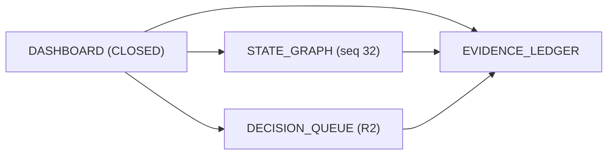

# Meta-OS Universal Ignite & Cockpit — Canli Pano

Navigasyon: [[DASHBOARD]] | [[STATE_GRAPH]] | [[DECISION_QUEUE]] | [[EVIDENCE_LEDGER]]

## 1. Sistem & Calisma Durumu Ozeti

| Alan | Deger |
| :--- | :--- |
| **Mevcut Durum (`current_state`)** | `CLOSED` |
| **Olay Gunlugu (`head_seq`)** | `32` (`run-0000.jsonl`) |
| **Birincil Arketip** | `CLI_SDK` |
| **Ikincil Arketipler** | `Autonomous_Agent, Data_ML_Pipeline` |
| **Risk Sinifi** | `R2` |
| **Son Kanit Makbuzu** | `sha256:de597e487325d1eb5f8556c0e425a5aeb38ea7bbd9238ead982257f921e50f01` |

## 2. Sütun 9.2 Meta-Metrics Karnesi (`I-07` Zero-Token Projection)

| Metrik | Deger | Hedef / Durum |
| :--- | :--- | :--- |
| `total_lead_time_seconds` | `420 s` | `< 3600 s` (PASS) |
| `llm_tokens_consumed` (Projeksiyon) | `0 token` | `0 token` (`I-07` PASS) |
| `estimated_cost_usd_cents` | `0 cent` | `< 500 cent` (PASS) |
| `circuit_breaker_trips` | `0` | `0` (PASS) |
| `false_positive_gate_count` | `0` | `0` (PASS) |
| `human_attention_seconds` | `180 s` | `3.0 dk` (PASS) |

## 3. Kokpit Dugum Topolojisi (Mermaid)

