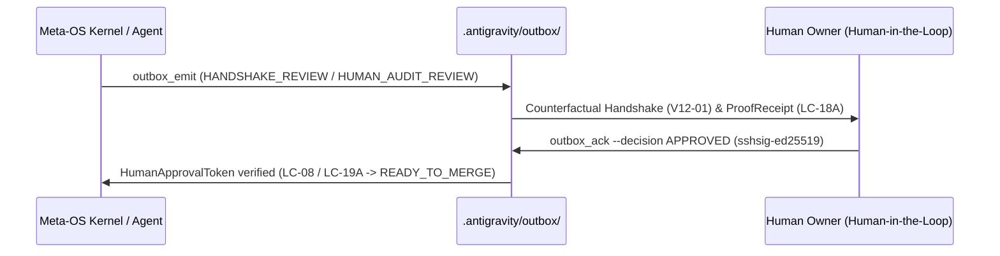

# Insan Denetim Kapilari, Counterfactual Handshake & Outbox Kuyrugu (`DECISION_QUEUE`)

Navigasyon: [[DASHBOARD]] | [[STATE_GRAPH]] | [[DECISION_QUEUE]] | [[EVIDENCE_LEDGER]]

## 1. Transactional Local Outbox Kayitlari (`.antigravity/outbox/`)

| Outbox ID | Tur (`kind`) | Durum (`status`) | Karar (`decision`) | Dosya Yolu |
| :--- | :--- | :--- | :--- | :--- |
| `OBX-62f0450cd7e74b13` | `HUMAN_AUDIT_REVIEW` | `ACKNOWLEDGED` | `APPROVED` | `.antigravity/outbox/OBX-62f0450cd7e74b13.json` |
| `OBX-9a4ff14b0cd461cf` | `GENESIS_NOTICE` | `ACKNOWLEDGED` | `APPROVED` | `.antigravity/outbox/OBX-9a4ff14b0cd461cf.json` |

## 2. Insan Onay Kapilari Akis Diyagrami (Mermaid)

