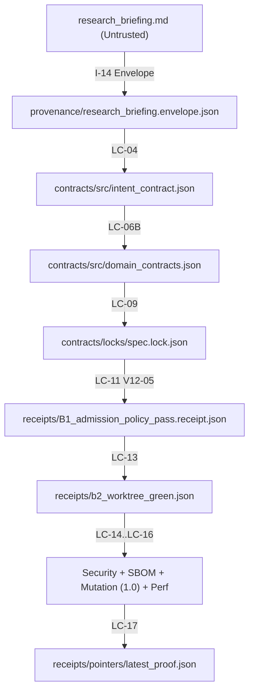

# Kriptografik Kanit Zinciri (`EVIDENCE_LEDGER`)

Navigasyon: [[DASHBOARD]] | [[STATE_GRAPH]] | [[DECISION_QUEUE]] | [[EVIDENCE_LEDGER]]

## 1. Uctan Uca Kanit Soyagaci (`IntentContract` -> `ProofReceipt`)

## 2. Mühürlü Artefakt ve Makbuz Tablosu

| Katman / Kapi | Artefakt Yolu | Durum |
| :--- | :--- | :--- |
| `I-09` Kernel Lock | `.antigravity/genesis/kernel_lock.json` | `VERIFIED (97 files)` |
| `I-14` Briefing Envelope | `provenance/research_briefing.envelope.json` | `NONE_DATA_ONLY` |
| `LC-04` IntentContract | `contracts/src/intent_contract.json` | `LOCKED` |
| `LC-09` Spec Lock | `contracts/locks/spec.lock.json` | `LOCKED` |
| `LC-11` Triple RED Oracle | `receipts/B1_admission_policy_pass.receipt.json` | `PASS (V12-05)` |
| `LC-14` Security & SBOM | `provenance/sbom/layer_b_sbom.json` | `PASS` |
| `LC-15` Mutation Verification | `receipts/b2_mutation_verification.json` | `PASS (1.0)` |
| `LC-16` Performance Proof | `receipts/b2_performance_scan_proof.json` | `PASS` |
| `LC-17` Proof Pointer | `receipts/pointers/latest_proof.json` | `sha256:de597e487325d1eb5f8556c0e425a5aeb38ea7bbd9238ead982257f921e50f01` |
