# Meta-OS Deterministik Yasam Dongusu Durum Makinesi (`STATE_GRAPH`)

Navigasyon: [[DASHBOARD]] | [[STATE_GRAPH]] | [[DECISION_QUEUE]] | [[EVIDENCE_LEDGER]]

## 1. Canli Durum Grafigi (`LC-01` .. `LC-22A`)

```mermaid
flowchart TD
    TECH_RADAR_SYNC --> CAPABILITY_BASELINED
    CAPABILITY_BASELINED --> GENESIS_MORPHING
    GENESIS_MORPHING --> GENESIS_LOCKED
    GENESIS_LOCKED -->|LC-04| INTENT_CAPTURED
    INTENT_CAPTURED -->|LC-05| RISK_CLASSIFIED
    RISK_CLASSIFIED -->|LC-06B| CONTRACT_DRAFTING
    CONTRACT_DRAFTING -->|LC-08| CONTRACT_REVIEWED
    CONTRACT_REVIEWED -->|LC-09| CONTRACT_LOCKED
    CONTRACT_LOCKED -->|LC-10| TESTS_ARMED_RED
    TESTS_ARMED_RED -->|LC-11| CHANGE_ADMITTED
    CHANGE_ADMITTED -->|LC-12| SANDBOX_EXECUTING
    SANDBOX_EXECUTING -->|LC-13| WORKTREE_GREEN
    WORKTREE_GREEN -->|LC-14| SECURITY_VERIFIED
    SECURITY_VERIFIED -->|LC-15| MUTATION_VERIFIED
    MUTATION_VERIFIED -->|LC-16| PERFORMANCE_VERIFIED
    PERFORMANCE_VERIFIED -->|LC-17| PROOF_ASSEMBLED
    PROOF_ASSEMBLED -->|LC-18A| HUMAN_AUDIT_REQUIRED
    HUMAN_AUDIT_REQUIRED -->|LC-19A| READY_TO_MERGE
    READY_TO_MERGE -->|LC-20| MERGED
    MERGED -->|LC-21| POST_DEPLOY_OBSERVING
    POST_DEPLOY_OBSERVING -->|LC-22A| CLOSED
    classDef visited fill:#1b4332,stroke:#40916c,color:#ffffff;
    classDef active fill:#d97706,stroke:#f59e0b,color:#ffffff,stroke-width:3px;
    class BREAK_GLASS_ACTIVE visited;
    class CAPABILITY_BASELINED visited;
    class CHANGE_ADMITTED visited;
    class CONTRACT_DRAFTING visited;
    class CONTRACT_LOCKED visited;
    class CONTRACT_REVIEWED visited;
    class GENESIS_LOCKED visited;
    class GENESIS_MORPHING visited;
    class HUMAN_AUDIT_REQUIRED visited;
    class INTENT_CAPTURED visited;
    class MERGED visited;
    class MUTATION_VERIFIED visited;
    class PERFORMANCE_VERIFIED visited;
    class POST_DEPLOY_OBSERVING visited;
    class PROOF_ASSEMBLED visited;
    class READY_TO_MERGE visited;
    class RISK_CLASSIFIED visited;
    class SANDBOX_EXECUTING visited;
    class SECURITY_VERIFIED visited;
    class TECH_RADAR_SYNC visited;
    class TESTS_ARMED_RED visited;
    class WORKTREE_GREEN visited;
    class CLOSED active;
```

## 2. Gecis Gecmisi (`run-0000.jsonl`)

| Seq | Kapi (`guard_id`) | Kaynak Durum | Hedef Durum | Dogrulanan Kanit |
| :--- | :--- | :--- | :--- | :--- |
| `4` | `LC-01` | `TECH_RADAR_SYNC` | `CAPABILITY_BASELINED` | `TechRadarDelta & CapabilityManifest` |
| `5` | `LC-02` | `CAPABILITY_BASELINED` | `GENESIS_MORPHING` | `ValidatedEnvironmentProfile` |
| `6` | `LC-03` | `GENESIS_MORPHING` | `GENESIS_LOCKED` | `UserApprovedProfile` |
| `11` | `EX-11` | `GENESIS_LOCKED` | `BREAK_GLASS_ACTIVE` | `CryptographicallySignedBreakGlassOverrideEvent` |
| `12` | `EX-12` | `BREAK_GLASS_ACTIVE` | `GENESIS_LOCKED` | `CryptographicallySignedBreakGlassReviewRecord & RealignmentProjectionReceipt` |
| `15` | `LC-04` | `GENESIS_LOCKED` | `INTENT_CAPTURED` | `InitializedWorkspace & ValidatedIntentContract` |
| `16` | `LC-05` | `INTENT_CAPTURED` | `RISK_CLASSIFIED` | `RiskClassAssignment & GateSchedule` |
| `17` | `LC-06B` | `RISK_CLASSIFIED` | `CONTRACT_DRAFTING` | `ContractDraft & CounterfactualHandshakeResult` |
| `18` | `LC-08` | `CONTRACT_DRAFTING` | `CONTRACT_REVIEWED` | `ThreatModelReport & ContractDiff` |
| `19` | `LC-09` | `CONTRACT_REVIEWED` | `CONTRACT_LOCKED` | `CanonicalSpecLockFile` |
| `20` | `LC-10` | `CONTRACT_LOCKED` | `TESTS_ARMED_RED` | `PropertyBasedTestSet & GoldenCases` |
| `21` | `LC-11` | `TESTS_ARMED_RED` | `CHANGE_ADMITTED` | `AdmissionPolicyPassReceipt(RedExecutionVerified_NonZeroExit)` |
| `22` | `LC-12` | `CHANGE_ADMITTED` | `SANDBOX_EXECUTING` | `EphemeralSandboxAllocation` |
| `23` | `LC-13` | `SANDBOX_EXECUTING` | `WORKTREE_GREEN` | `IsolatedWorktreeBuildSuccess` |
| `24` | `LC-14` | `WORKTREE_GREEN` | `SECURITY_VERIFIED` | `ArchetypeSecurityScanProof` |
| `25` | `LC-15` | `SECURITY_VERIFIED` | `MUTATION_VERIFIED` | `MutationScorePass & Non-SurvivingInvariants` |
| `26` | `LC-16` | `MUTATION_VERIFIED` | `PERFORMANCE_VERIFIED` | `ArchetypePerformanceScanProof` |
| `27` | `LC-17` | `PERFORMANCE_VERIFIED` | `PROOF_ASSEMBLED` | `CompleteProofReceiptPackage` |
| `28` | `LC-18A` | `PROOF_ASSEMBLED` | `HUMAN_AUDIT_REQUIRED` | `CompleteProofReceiptPackage` |
| `29` | `LC-19A` | `HUMAN_AUDIT_REQUIRED` | `READY_TO_MERGE` | `CompleteProofReceiptPackage & HumanApprovalToken` |
| `30` | `LC-20` | `READY_TO_MERGE` | `MERGED` | `GitMergeSuccess & AppendOnlyEventRecord` |
| `31` | `LC-21` | `MERGED` | `POST_DEPLOY_OBSERVING` | `CanaryDeploymentTelemetry` |
| `32` | `LC-22A` | `POST_DEPLOY_OBSERVING` | `CLOSED` | `FinalStateLock & StabilityReceipt` |
